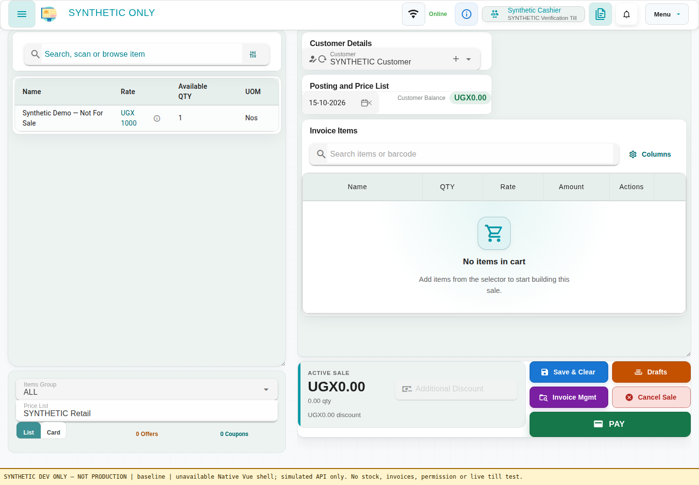
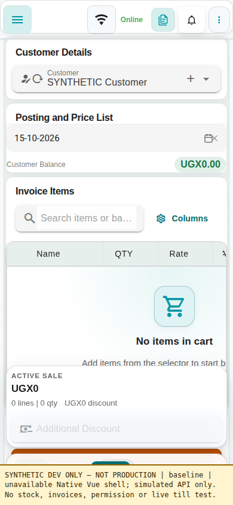
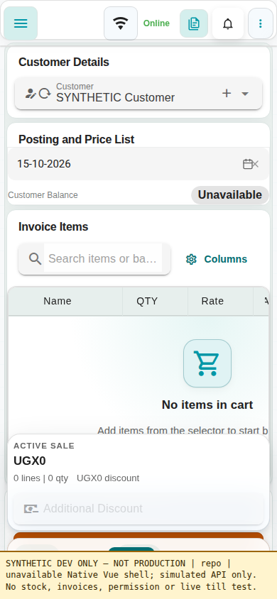

# Customer balance: unavailable is not zero

Synthetic development-browser evidence. No real tenant/customer data or
production requests are included. This contribution was AI-assisted, with
test-first implementation and independent review; it is not maintainer approval.

## Capture boundary

The actual Vue application is mounted through `mountPosApp`: App, layout,
router, stores, Invoice and PostingDateRow. Only the Frappe session/API browser
boundary is simulated. These are full-application development-server captures,
not recreated HTML or a replacement balance renderer. API values are synthetic.

- Before: upstream develop `ac4542c92b5838b378f851a580490f6dc3b27bda`.
- After UI source: `0c7821d2846f445d4d9ab012c427403220422391`.
- Final production source: `e1bfff2225cefe0ef0bc7267f734f6ef88410536`.
  Later changes are test-harness refinement and a Python-only metadata correction;
  the captured frontend source is unchanged.
- Desktop: 1440 x 1000. Mobile: 390 x 844, native Cart view.
- POS Profile balance and posting-header visibility enabled in both.
- Local Vite development server and headless Chrome; external requests blocked.
- Frontend package/lock unchanged, frozen Yarn 1.22.22 dependencies.

| Viewport | Before: API balance null | After: API balance null |
| --- | --- | --- |
| Desktop |  |  |
| Mobile |  |  |

Both baseline unavailable cases incorrectly render `UGX0.00`. Both candidate
unavailable cases render neutral `Unavailable`. Genuine zero remains a number.

Eight candidate browser cases cover null, genuine zero, positive 12,500 and
negative -12,500 at both widths. All load the synthetic native profile, unlock
the terminal and make exactly one balance request, with no page exceptions.
Four baseline cases cover unavailable and genuine zero at both widths.
See [sanitized results and screenshot hashes](browser-results.json).

The isolated development environment logs 7-8 console errors per case for
blocked HMR/service-worker/probes and missing local assets, plus inherited Vue
warnings. One background service-worker fetch reports context teardown after
the desktop-positive capture; no page exception. This is not clean-console,
physical-device, native backend permission, completed-sale or live-till proof.
The screenshots retain unrelated inherited layout limitations; this is not a
general redesign of the POS or a complete SAP/Fiori parity claim.

## Behavior and limits

The existing native ERPNext summary remains the balance authority. Missing
summaries/company values and errors return null, not a false monetary zero.
A native `None` summary preserves the previous withholding of customer name.
Known values and native permission behavior are unchanged.

The loader discards late responses after customer/company/session changes and
never displays cached financial values as current online/offline balances.
Existing cache helpers use session-user/company/customer tuple keys, reject
legacy unscoped entries and invalidate unavailable scoped entries.

Offline balances intentionally show unavailable, rather than adding a new
freshness mechanism or implying immediate offline permission-revocation checks.
This does not redesign endpoint authorization, calculate balances, change credit
limits or invoice/payment/stock payloads, grant permissions, or establish that
every cache byte is purged at logout. No dependency or service is added.

## Test-first evidence

- Tests-only RED `33569a72`: frontend 42 failed / 5 passed; Python five failing
  methods (six failing assertions including subtests) out of 11. Initial harness
  failures were corrected before this commit and are not counted as valid RED.
- Minimum GREEN `0c7821d2`: focused frontend 47/47; Python 11/11.
- Stable test-harness refinement `aa421b2f`: full frontend 235 files / 1,193
  tests passed, no failures/skips. Production typecheck/build, Chrome109 CSS
  audit and frontend lint passed at this revision. An earlier full-suite attempt
  failed three unrelated harness controls; compiler settings were preserved and
  controls corrected, without excluding tests or changing unrelated production.
- Linked frontend: 80/80; parent six-file adjacent selection: 17/17 on both
  untouched base and candidate. These are separate selections, not additive.
- Metadata tests-only RED `7570cb1c`: 10 passed / 1 genuine customer-name
  disclosure failure. Minimum Python-only GREEN `e1bfff22`: focused 11/11,
  available linked Python 28/28 (includes focused 11), frontend focused 47/47.
  No skips. Full frontend/build/lint were not rerun for this Python-only change;
  their earlier results remain tied to the unchanged frontend at `aa421b2f`.
- Ruff 0.16.4 reports five findings in the two touched Python files, reproduced
  identically on the pre-follow-up baseline. Not a green Python lint claim.
- Native `test_pos_access` cannot import Frappe locally, reproduced on the
  untouched upstream base. Actual native authorization/integration remains
  **CANNOT-VERIFY**, not skipped or covered by the available unit selection.

Reproducible commands from the repository root:

```bash
PYTHONDONTWRITEBYTECODE=1 python3 -m unittest posawesome.posawesome.api.test_customers posawesome.posawesome.api.test_offline_sync_customers posawesome.posawesome.api.test_customer_credit_invoice_fields posawesome.posawesome.api.test_api_imports posawesome.posawesome.api.test_pos_authorization -v
```

From `frontend`:

```bash
yarn test:unit tests/customerBalance.spec.ts tests/postingDateRowBalance.spec.ts --maxWorkers=1 --minWorkers=1
yarn test:unit --maxWorkers=2 --minWorkers=1
yarn build
yarn lint
```

An authorized native test bench must separately verify ordinary-role reads,
permission-denied behavior and till acceptance. No live financial or inventory
record was created or changed to produce this evidence.

Design reference: [SAP Fiori empty states](https://www.sap.com/design-system/fiori-design-web/v1-151/foundations/best-practices/global-patterns/designing-for-empty-states)
distinguishes no data from permission/configuration/system errors. Here a small
existing translated Vue status is appropriate; unavailable data is not success
or a zero balance. No new design framework is needed for this bounded defect.
