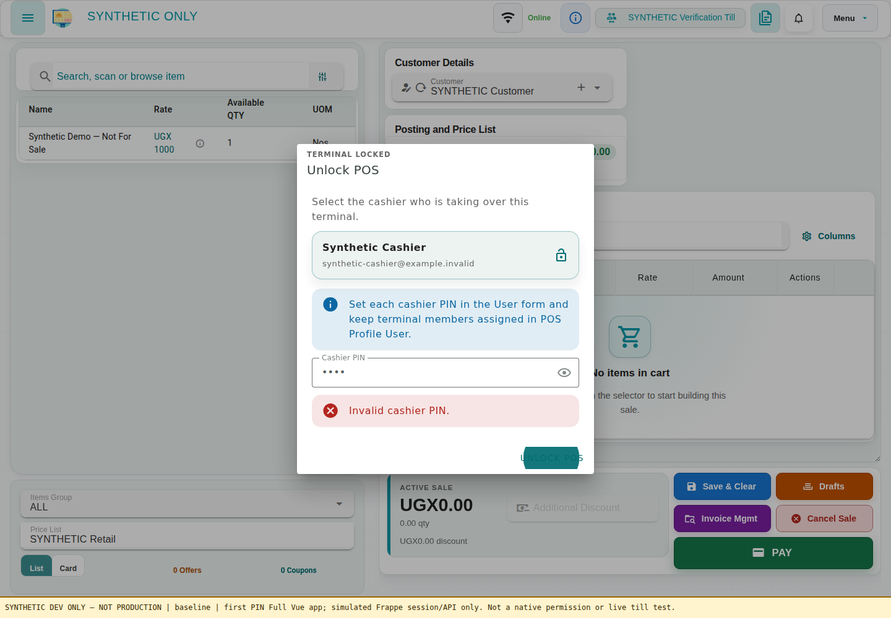
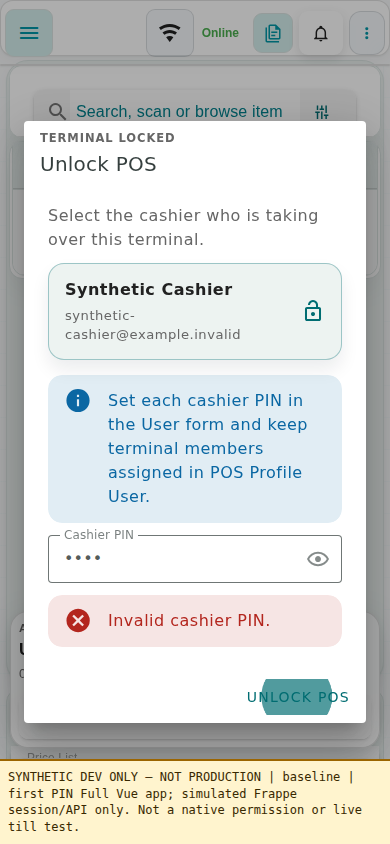
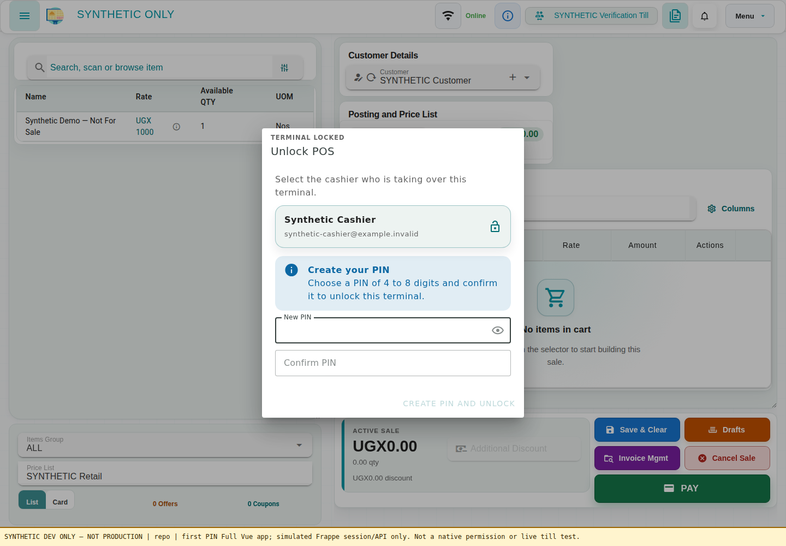
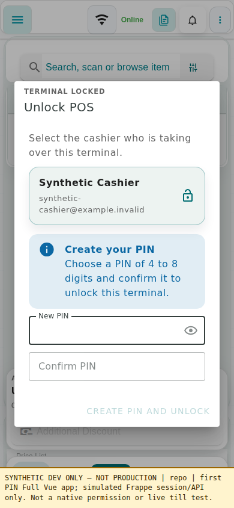
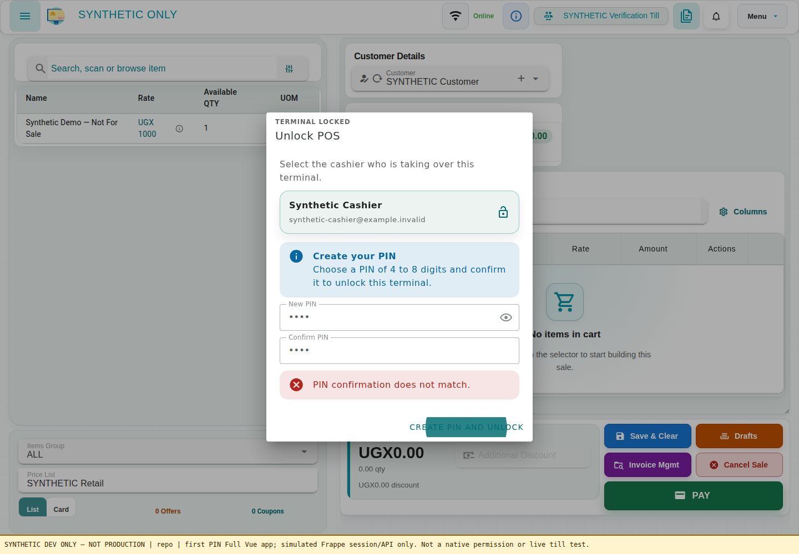
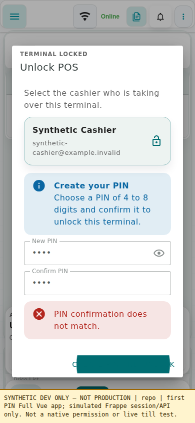
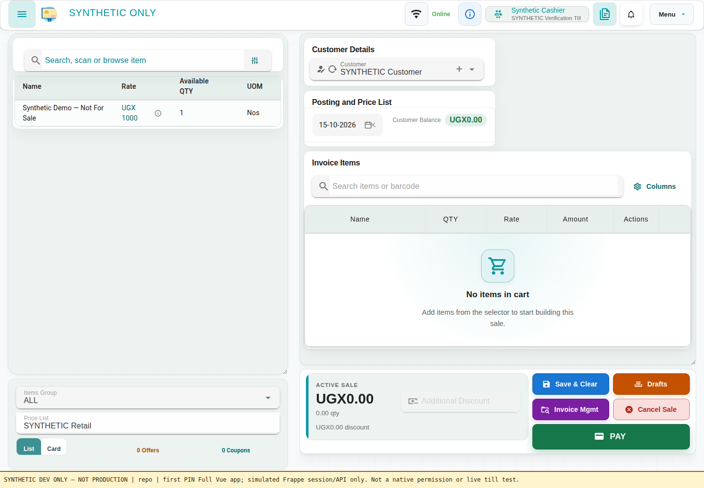
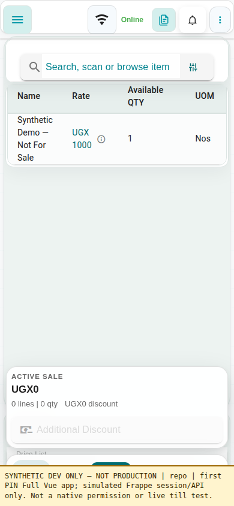

# First-use cashier PIN: synthetic development evidence

These screenshots use the real POS Awesome Vue application, Vuetify controls
and changed EmployeeSwitchDialog, served by Vite with a simulated Frappe
session/API. All names, company data and stock are synthetic. No real PIN is
captured. They are **not production screenshots**, a native Frappe permission
test, or an accepted deployment pin.

Source base: `ac4542c92b5838b378f851a580490f6dc3b27bda`.
Tests-only RED: `a6f750c098195db98ded30570623a820c8cd57b3`.
Production GREEN: `c53dc421cf22404e626e2da60b3d8d7f32d43c5c`.
This evidence-only commit does not change application code.

## Before

The signed-in synthetic cashier has no PIN and is stuck at the locked till.

## After: choose and confirm your PIN

## Mismatch stays locked

## Server-confirmed operator unlocks

The backend response is simulated for visual verification. Native terminal
authorization, transaction and ordinary-role behavior still require integration
testing; visual evidence alone cannot prove them.

## Verification boundary

Focused source tests cover PIN and confirmation validation, failed saves,
stale first-use overwrite denial, other-cashier restrictions, repeated-click
protection, normal PIN switching and server-confirmed terminal state.

The feature keeps the existing 4-8 digit policy and existing lockout and
assignment rules; it does not implement administrative forgotten-PIN reset,
change pricing/stock/payment logic, or add a default shared PIN.

Raw simulated call traces are intentionally not included: PIN arguments do
not belong in evidence, even when the fixture is synthetic.
